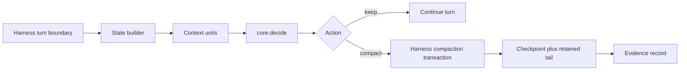

# Architecture

**Status:** Proposed · **Governing decisions:** [ADR-0001](../decisions/ADR-0001-hazard-rate-distortion-model.md), [ADR-0002](../decisions/ADR-0002-adapter-architecture.md)

## 1. Summary

OptCompact is one decision engine with three thin adapters. The engine is pure, deterministic, and dependency-free. Each adapter translates a harness session into the engine state, applies the returned decision through the harness's own compaction transaction, and emits evidence.

The design keeps the model testable in isolation and keeps harness code replaceable. A new harness costs one state builder and one action executor, not a new model.

## 2. Package boundaries

| Package | Role | Runtime dependencies |
|---|---|---|
| `@optcompact/core` | Model, estimators, decision rule, metrics | none |
| `@optcompact/dsh` | DeepSeek Harness plugin and state builder | `@deepseek-ai/dsh-*` peer packages |
| `@optcompact/codex` | Codex adapter and hook bridge | Node standard library |
| `optcompact` | CLI: simulate, explain, calibrate, doctor | `@optcompact/core` |

Rules:

- `core` must not import a harness package or perform I/O.
- Adapters must not re-implement the decision rule. They build state and execute actions.
- Adapters must degrade to `keep` when the harness cannot supply a required signal.
- Every adapter decision must be loggable as the core `Decision` object.

## 3. Data flow



The state builder reads four inputs: token pressure, growth rate, per-unit metadata, and prices. Missing inputs use documented defaults, never guesses hidden in the adapter.

## 4. DeepSeek Harness adapter

DeepSeek Harness exposes a compaction seam: `ctx.compaction` is a `CompactionEngine` service, and `@deepseek-ai/dsh-compaction-basic` implements it. The seam owns the durable transaction, tool-pair balance, checkpoint framing, and overflow recovery.

The adapter extends `BasicCompactionEngine` and overrides `compactIfNeeded`. It keeps the inherited summarizer, `/compact` command, and overflow recovery. On a `pressure` trigger it consults `core.decide` and either returns `null` or calls `compactRegion` with the computed cut.

Why a subclass rather than a sibling plugin:

- the inherited transaction is already correct and log-recorded;
- `compactIfNeeded` is dynamically dispatched, so one override changes policy without copying summarization;
- overflow recovery must stay untouched, because it is the last-resort path.

Constraints inherited from the harness:

- a region cut must be balanced across tool calls and results;
- automatic compaction requires an open turn;
- the system prompt at surface node 0 is never shadowed;
- the summary call reuses the provider prefix cache only when it replays the same prefix.

## 5. Codex adapter

Codex does not expose the same compaction seam. The adapter therefore uses the strongest available integration point and states its limits. The exact mechanism and evidence live in [`docs/research/codex-compaction-surface.md`](../research/codex-compaction-surface.md).

Two invariants hold regardless of mechanism:

- the adapter must observe token usage per turn;
- the adapter must trigger compaction through a supported Codex surface, never by editing Codex state.

## 6. Evidence and observability

Every decision produces a record:

```json
{
  "turn": 42,
  "action": "compact",
  "urgency": "soft",
  "cutIndex": 7,
  "shadowTokens": 41200,
  "retentionRatio": 0.16,
  "expectedGainTokens": 183000,
  "expectedQualityLoss": 9100,
  "cer": 6.4,
  "reasons": ["positive-gain"],
  "load": 0.62
}
```

Records are append-only JSONL under the session log directory. The CLI reads them to produce a session report and to calibrate parameters.

## 7. Failure modes

| Failure | Behavior |
|---|---|
| Harness supplies no window size | Keep, log `missing-window` |
| Token meter unavailable | Keep, log `missing-meter` |
| Decision throws | Keep, log the error, never block the turn |
| Compaction transaction fails | Propagate the harness error unchanged |
| State has one unit | Keep, log `insufficient-units` |

The engine is advisory by construction. A failure must never stop the agent.

## 8. Testing strategy

- **Core:** unit tests for each formula, property tests for invariants, golden tests for decision records.
- **Adapters:** contract tests against a fake harness that reproduces the real event and transaction shapes.
- **Simulator:** seeded Monte Carlo comparison of policies against ground-truth reuse.
- **Docs:** the `docs-ops` checker plus link checks in CI.

The full matrix is in [`docs/qa/testing-strategy.md`](../qa/testing-strategy.md).
